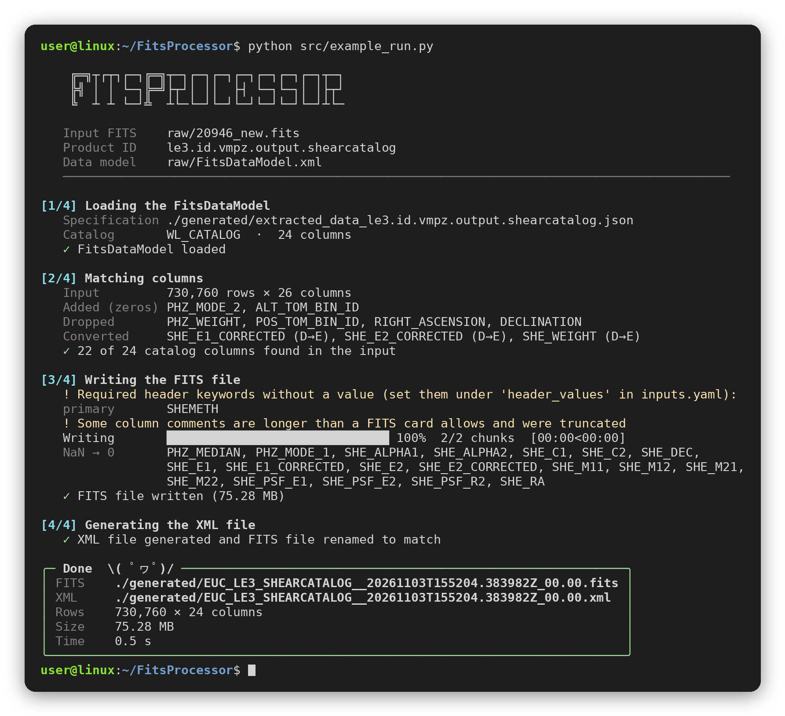

# FitsProcessor

A program to create Euclid LE3 data products (e.g. the position, shear and proxyshear catalogs) from a simulated FITS file and the FitsDataModel XML: a FITS file matching the data model, and the corresponding XML metadata.

<p align="center">
  
</p>

## Features

- **Matches the FitsDataModel**: The input columns are renamed, reordered and converted to the formats of the data model. The missing columns are added (initialised with zeros), extra columns are dropped and NaN values are replaced with zeros. Headers are reduced to the keywords required by the data model.
- **Handles very large files**: The input is streamed in chunks (read once, written once), so memory use stays low regardless of the file size (e.g. a 74 million row catalog is processed in under 20 seconds with ~100 MB of memory).
- **Safe**: The input file is never modified. The output is written to a temporary file and only moved into place once complete.
- **Clear output**: Each step reports what was renamed, added, dropped and converted, and a final summary lists the generated FITS and XML file names.

## Installation

To install the package, clone the repository, navigate to the project directory and run:

```bash
pip install .
```

### Using Docker
If you have Docker installed already, you can download the Image for FitsProcessor from the DockerHub using the command
```bash
docker pull cchawak/fitsprocessor:v1.0.0
```

Once the image is downloaded, you can run it using
```bash
docker run --rm -it cchawak/fitsprocessor:v1.0.0
```

This will open up a bash terminal allowing access to the container.

One final step before entering the execution phase is the activation of the venv. Run the following in the default dir (which should be '/workdir')
```bash
source .venv/bin/activate
```

> NOTE : If the container cannot reach the internet (e.g. on some institute networks), add `--network host` to `docker build` / `docker run`

## Configuration

Before running the program, modify the `src/config/inputs.yaml` file to specify the following parameters:
- input_fits_path
- product_id \
(Example: 'le3.id.vmpz.output.shearcatalog'; 'le3.id.vmpz.output.poscatalog'; 'le3.id.vmpz.output.proxyshearcatalog')
- fits_data_model \
(Example: 'latest' OR '<specific_version>' (e.g. '9.2.3') OR '<path_to_file>' (e.g. 'raw/FitsDataModel.xml'))
- display_output (bool; displays the headers and the first 100 rows of the generated FITS file)
- PAT (the Personal Access Token for your Gitlab account - with at least read permission; only needed when fits_data_model is 'latest' or a version)
- header_values (optional; values for header keywords required by the FitsDataModel, e.g. NSIDE / ORDERING for HEALPix maps)

```yaml
header_values:
  primary:
    SHEMETH: "LensMC"
  table:
    NSIDE: 4096
    ORDERING: "NESTED"
```

If the column names in the input file differ from the FitsDataModel, add the renames for the product to `src/config/column_mappings.yaml` (input name → catalog name).

The generic header configuration for the XML will be set as per the default values in `src/config/XmlHeaderDetails.yaml`. Modify only the 'header.default' values if necessary.

All the files that are required by the program (e.g. FitsDataModel.xml) should be in the 'raw' folder at the root of the project directory.

All the files generated from this program will be saved in the 'generated' folder present at the root of the project directory.

Standalone utilities for large FITS files (splitting, merging, column swapping, ...) are in the 'tools' folder; see `tools/README.md`.

Generating the XML file for the FITS file requires access to the EDEN environment.

## Executing

After configuring the inputs, run the program from the root of the project directory using:

```bash
python src/example_run.py
```
This will generate the final product (fits + xml) in the 'generated' folder:
- the FITS file is first written as `generated/<product_id>.fits`
- once the XML is generated, the FITS file is renamed to match it (`EUC_LE3_<TYPE>__<timestamp>Z_00.00.fits` / `.xml`)

The final file names are shown in the summary at the end of the run. Make sure there is enough disk space for the output, which can be larger than the input when columns are added.

To run the validation script (for both fits and xml files) execute the following in EDEN environment:

```bash
ERun ST_DataModelTools 10.1.8 python src/validation.py
```

> NOTE : By default the last generated product by the `src/example_run.py` will be considered for validation. To choose a custom product, change the 'fits_filepath' and 'xml_filepath' parameters in the `src/config/XmlHeaderDetails.yaml` file.

## Adding a new product

The FITS file can be generated for any product of the FitsDataModel that has a single table HDU (e.g. the HEALPix/MOC maps and masks, `le3.id.catalog`, `le3.id.vmpz.output.cat`), without code changes:

1. Set `product_id` in `src/config/inputs.yaml`.
2. Add the column renames to `src/config/column_mappings.yaml`, if needed.
3. Provide the values of the required header keywords, either in the input file headers or under `header_values` (keywords left without a value are listed in the output).

To also generate the XML, add the product to `names_database` in `src/xmlgenerator.py` with its binding classes from `ST_DataModelBindingsXsData` (see the comment above `names_database`). Products with several table HDUs are not supported yet.
